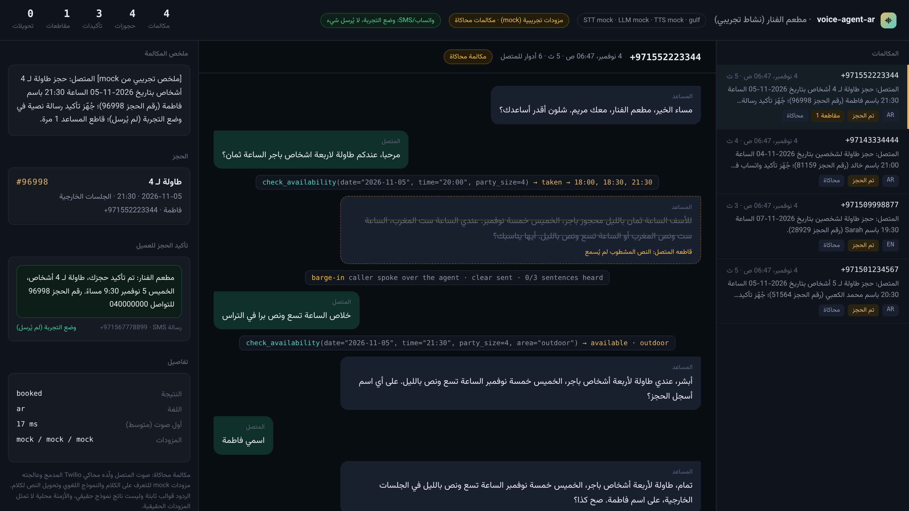
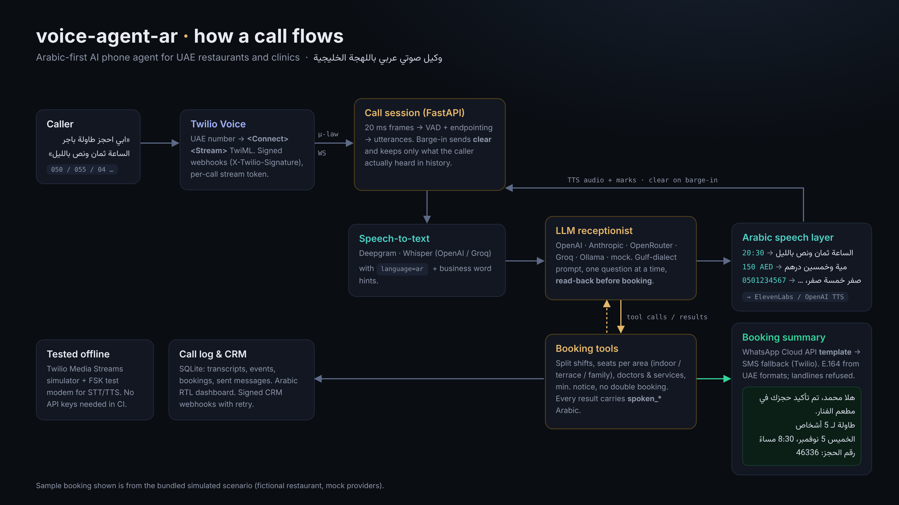

[العربية](README.md) | **English**

# voice-agent-ar: Arabic AI phone agent for UAE restaurants and clinics

**An open-source AI voice agent that answers your phone in Gulf (Emirati) Arabic, books tables and appointments over Twilio, reads times and prices aloud like a person from Dubai, and sends the booking summary to the caller by WhatsApp template or SMS.**

[](https://github.com/mohammadhadijavidi/voice-agent-ar/actions/workflows/ci.yml)
[](LICENSE)
[](pyproject.toml)
[](https://www.twilio.com/docs/voice/media-streams)
[](https://developers.facebook.com/docs/whatsapp/cloud-api)



<sub>A real screenshot of the bundled dashboard after running the built-in simulated calls. The restaurant, callers and phone numbers are fictional samples. The agent's replies come from the deterministic <b>mock</b> receptionist (templates, not a real model); the booking, availability, barge-in and the WhatsApp/SMS request (dry-run, nothing sent) are produced by the real code.</sub>

## Why

Restaurants and clinics in Dubai and Abu Dhabi miss calls at peak times, and most callers speak Gulf Arabic: "ابي طاولة باجر الساعة ثمان ونص بالليل لخمسة". Generic voice-agent templates are built for English. Pointing them at Arabic fails in predictable places:

- **Understanding.** "باجر", "عقب باجر", "سبع إلا ربع", "احنا خمسة", "برا في التراس", "ايه صح": dates, times, party size and confirmations in Gulf dialect.
- **Speaking.** TTS reads "20:30" or "150 AED" in Arabic unpredictably (English digits, or "twenty colon thirty"). Callers should hear "الساعة ثمان ونص بالليل" and "مية وخمسين درهم".
- **Local reality.** Split lunch/dinner shifts, a family section, UAE number formats (050 / 055 / +971 / 04 landlines), and confirmations through WhatsApp, which in the UAE matters more than email.

There are commercial Arabic voice-agent platforms for MENA (closed SaaS). My search did not find an open-source project that combines a Gulf-Arabic phone conversation design with real booking logic and a WhatsApp confirmation. **voice-agent-ar** is that project: a small Python service you run yourself, with any LLM, STT and TTS provider, tested end to end without API keys.

It is the Arabic-first sibling of [voice-agent-starter](https://github.com/mohammadhadijavidi/voice-agent-starter) (a general English template) and shares its audio core: Media Streams, VAD, barge-in and the simulator.

## Features

- **Gulf-dialect conversation design.** Emirati phone register ("حياك الله", "أبشر", "صح كذا؟"), one question at a time, and a mandatory **read-back before booking**: the `create_booking` tool refuses unless `confirmed_by_caller=true`. MSA mode (`DIALECT=msa`) for businesses that prefer formal Arabic. English callers are answered in English.
- **Arabic numbers and times as people say them** (`arabic/numbers.py`, `arabic/speak.py`): hours with ونص / وربع / إلا ربع / إلا ثلث and the part of day (الصبح، الظهر، العصر، المغرب، بالليل); counted nouns with the right Arabic agreement (شخصين، خمسة أشخاص، إحدعش شخص); prices in dirhams; dates with باجر / عقب باجر; phone numbers and booking codes read digit by digit in local groups. Every LLM sentence passes through this layer before TTS, so **the TTS never receives a digit**. The call log keeps the original text.
- **Gulf Arabic understanding** (`arabic/gulf.py`): days (باجر، بكرة، الليلة، يوم الخميس، 5/11، خمسة نوفمبر), times (ثمان ونص بالليل، على 9، ٤ العصر) with hour disambiguation against opening hours, party size (لخمسة، احنا ستة، انا وزوجتي), seating area (برا، التراس، قسم العوايل), names (على اسم محمد الكعبي), yes/no, goodbye, asking for a human, medical emergencies. The tools accept these forms too, so a model may pass "باجر" or "ثمان ونص بالليل".
- **UAE phone formats** (`arabic/phone.py`): `050 123 4567`, `+971 50…`, `00971…`, Arabic-Indic digits and numbers spoken as words, all normalised to E.164. Mobile prefixes 050/052/054/055/056/058, landlines 02/03/04/06/07/09. A landline cannot receive WhatsApp, so the agent asks for a mobile.
- **Real restaurant and clinic logic.** Restaurant: split shifts, midnight closing, seats per area per sitting (90 minutes), max party size, minimum notice. Clinic: services with duration and price, doctors with working days, automatic doctor assignment, no appointment that runs into the break.
- **Booking summary via WhatsApp or SMS.** A ready-to-submit Arabic **WhatsApp template** (UTILITY category, required because the caller never messaged you, so there is no open 24-hour window) through the Cloud API, falling back to Twilio SMS (short UCS-2 body). **Dry-run by default**: the exact request is built and logged, nothing is sent, and nothing pretends it was.
- **Natural phone behaviour.** Barge-in: the caller can interrupt, the agent stops (Twilio `clear`) and the model history keeps only the sentences the caller actually heard. Transfer to staff over the Twilio REST API, or take a message. Emergencies in a clinic: the agent gives the ambulance number (998) first.
- **Any provider.** LLM: OpenAI, OpenRouter, Groq, Ollama, LM Studio (any OpenAI-compatible base_url), Anthropic, and mock. STT: OpenAI (gpt-4o-transcribe / whisper-1), Groq Whisper, Deepgram (raw mu-law). TTS: ElevenLabs (native ulaw_8000) and OpenAI. Language forced to Arabic, with business word hints for STT.
- **Arabic RTL dashboard.** Calls, transcripts, cut-off replies, tool calls, booking cards and a preview of the WhatsApp/SMS message. Plus signed CRM webhooks (n8n, Zapier, Make, HubSpot) with a retrying outbox.
- **Tested without keys.** A Twilio Media Streams simulator calls the real server over a real WebSocket (μ-law, 20 ms frames, marks, clear, stop). 137 tests and 6 complete call scenarios.

## Quick start

```bash
git clone https://github.com/mohammadhadijavidi/voice-agent-ar
cd voice-agent-ar
pip install -e .

# 6 simulated calls, no API keys (mock STT/LLM/TTS, WhatsApp/SMS dry-run)
voice-agent-ar simulate all

# hear how a sentence will be spoken
voice-agent-ar say "حجزك الساعة 20:30 لـ 4 أشخاص، الكشف 150 درهم"
# -> حجزك الساعة ثمان ونص بالليل لأربعة أشخاص، الكشف مية وخمسين درهم

# open the call log from the simulation (the path is printed at the end)
voice-agent-ar serve --db /tmp/voice-agent-ar-XXXX/sim.db   # then http://localhost:8080
```

Real calls:

```bash
cp .env.example .env        # fill in keys, PUBLIC_URL, Twilio, PROFILE
voice-agent-ar doctor       # shows what is configured and what is missing
voice-agent-ar serve        # or: docker compose up -d
```

In the Twilio console, set your number's Voice webhook to `POST https://<PUBLIC_URL>/twilio/voice`. Full steps, including the WhatsApp template and SMS sender: [examples/twilio_setup.md](examples/twilio_setup.md).

## Configuration

Everything is set through environment variables (see [.env.example](.env.example)).

| Layer | `*_PROVIDER` | Notes |
|---|---|---|
| LLM | `openai`, `openrouter`, `groq`, `ollama`, `lmstudio`, `anthropic`, `mock` | Any OpenAI-compatible server through `LLM_BASE_URL`. Streaming + tool calling. |
| STT | `openai`, `groq`, `deepgram`, `mock` | `STT_LANGUAGE=ar` by default; profile `stt_hints` are sent as a prompt (Whisper) or keyterms (Deepgram, opt-in). |
| TTS | `elevenlabs`, `openai`, `mock` | `TTS_VOICE_AR` / `TTS_VOICE_EN`. ElevenLabs returns Twilio-native μ-law 8 kHz. |
| Confirmation | `NOTIFY_CHANNEL` = `whatsapp`, `sms`, `whatsapp_then_sms`, `none` | `NOTIFY_DRY_RUN=true` by default. WhatsApp: `WHATSAPP_TOKEN`, `WHATSAPP_PHONE_NUMBER_ID`, `WHATSAPP_TEMPLATE`. SMS: `SMS_FROM` + Twilio. |
| Business | `PROFILE` | `restaurant`, `clinic` (fictional samples) or the path to your YAML ([restaurant template](examples/my_restaurant.yaml), [clinic template](examples/my_clinic.yaml)). |
| Style | `DIALECT` | `gulf` (default) or `msa`. |

**Which providers for Gulf Arabic?** Quality varies a lot between engines and voices, and changes quickly. Test with your own callers before going live: `gpt-4o-transcribe` or Whisper large for STT, and an Arabic voice from the ElevenLabs Voice Library (`eleven_flash_v2_5` for low latency) are reasonable starting points. Nothing in this repository claims a measured accuracy for any provider.

## Usage examples

**Your own business:** copy `examples/my_restaurant.yaml`, edit the hours, seating areas, greeting and phone, then `PROFILE=path/to/file.yaml voice-agent-ar serve`.

**Your own test call:**

```yaml
# examples/custom_scenario.yaml
profile: restaurant
caller: "+971501112233"
steps:
  - say: "السلام عليكم، ابي طاولة في قسم العوايل يوم الجمعة"
  - say: "بنكون سبعة"
  - say: "الساعة سبع ونص بالليل"
  - say: "على اسم ام سعيد"
  - say: "ايه صح"
```

```bash
voice-agent-ar simulate examples/custom_scenario.yaml
```

**Use the Arabic layer in your own code:**

```python
from datetime import date
from voice_agent_ar.arabic import gulf, parse_uae_phone, time_to_words
from voice_agent_ar.arabic.speak import to_speech

gulf.parse_day("عقب باجر", date(2026, 11, 4))         # date(2026, 11, 6)
gulf.parse_time("سبع إلا ربع بالليل").resolve()          # "18:45"
gulf.parse_party_size("احنا خمسة اشخاص")                 # 5
parse_uae_phone("٠٥٥ ٢٢٢ ٣٣٤٤").e164                     # "+971552223344"
time_to_words("20:30")                                  # "الساعة ثمان ونص بالليل"
time_to_words("20:30", "msa")                           # "الساعة الثامنة والنصف مساءً"
to_speech("السعر 1250 درهم")                             # "السعر ألف وميتين وخمسين درهم"
```

**Add a tool** (for example, today's special): see [examples/custom_tool.py](examples/custom_tool.py).

A simulated call (`voice-agent-ar simulate restaurant_booking`, mock providers):

```
AGENT : مساء الخير، مطعم الفنار، معك مريم. شلون أقدر أساعدك؟
CALLER: السلام عليكم، ابي احجز طاولة باجر الساعة ثمان ونص بالليل
AGENT : حياك الله. كم شخص بتكونون؟
CALLER: بنكون خمسة اشخاص
AGENT : أبشر، عندي طاولة لخمسة أشخاص باجر، الخميس خمسة نوفمبر الساعة ثمان ونص بالليل. على أي اسم أسجل الحجز؟
CALLER: على اسم محمد الكعبي
AGENT : تمام، طاولة لخمسة أشخاص باجر، الخميس خمسة نوفمبر الساعة ثمان ونص بالليل في الصالة الداخلية، على اسم محمد الكعبي. صح كذا؟
CALLER: ايه صح
AGENT : تم الحجز يا محمد الكعبي، رقم الحجز أربعة ستة ثلاثة ثلاثة ستة. أرسل لك التأكيد على الواتساب على الرقم اللي آخره أربعة خمسة ستة سبعة؟
CALLER: ايه ارسله على الواتساب
AGENT : أبشر، بيوصلك ملخص الحجز على الواتساب على الرقم اللي آخره أربعة خمسة ستة سبعة. تبي شي ثاني؟
confirmation: whatsapp -> +971501234567 [dry_run]
```

## How it works



1. A call reaches your Twilio number. `/twilio/voice` validates `X-Twilio-Signature` and returns `<Connect><Stream>` TwiML with a per-call token.
2. Twilio streams 8 kHz μ-law audio over a WebSocket. The session splits it into utterances with VAD and endpointing.
3. Each utterance goes to STT (language `ar`, business hints). The text and the system prompt (Gulf style, flow rules and the business facts) go to the LLM.
4. The LLM calls tools: `check_availability`, `create_booking` (only after the read-back yes), `send_booking_summary`, `cancel_booking`, `transfer_to_human`, `take_message`, `end_call`. Results carry ready-to-say `spoken_*` fields.
5. Each sentence passes through `to_speech()` (digits, times, prices and phone numbers to Arabic words), then TTS, then back to Twilio with a `mark`. If the caller talks over the agent, `clear` is sent and the history keeps only what was heard.
6. After booking, the WhatsApp template (or SMS) goes to the caller's mobile, and the CRM receives `booking.created` and `call.completed` with an Arabic summary.

Code map: `arabic/` (language layer) · `prompts.py` (conversation design) · `tools.py` (booking logic) · `notify.py` (WhatsApp/SMS) · `agent.py` (call session) · `simulator.py` (Twilio simulator) · `providers/` (LLM/STT/TTS).

## Roadmap

- Streaming STT (Deepgram live / OpenAI realtime) to cut latency.
- Benchmarks of STT and TTS providers on recorded (consented) Gulf Arabic calls.
- Reschedule a booking by code; reminders the day before via a WhatsApp template.
- Sync with Google Calendar and restaurant booking systems.
- More dialects: Saudi (Najdi / Hejazi), Kuwaiti, Egyptian for Dubai's many Egyptian callers.
- Outbound calls to confirm bookings.

## Contributing

Gulf phrases that are not understood are the most useful contribution: add them to `arabic/gulf.py` with a test. See [CONTRIBUTING.md](CONTRIBUTING.md).

## License

MIT, see [LICENSE](LICENSE). The bundled Vazirmatn font is under the SIL Open Font License ([OFL.txt](src/voice_agent_ar/static/fonts/OFL.txt)).

Respect the laws and platform rules where you operate: tell callers they are speaking with an automated assistant, keep call recordings and transcripts only as your privacy policy allows (UAE PDPL), use only approved WhatsApp templates, and register your SMS sender ID.

---

Built by [Mohammad Hadi Javidi](https://github.com/mohammadhadijavidi) — AI products & automation, Dubai.
