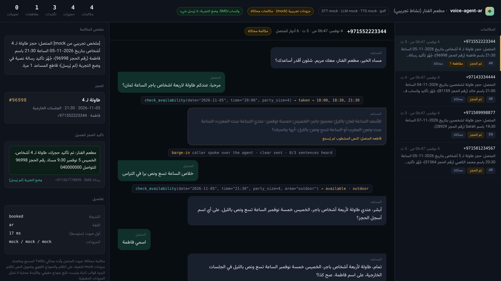
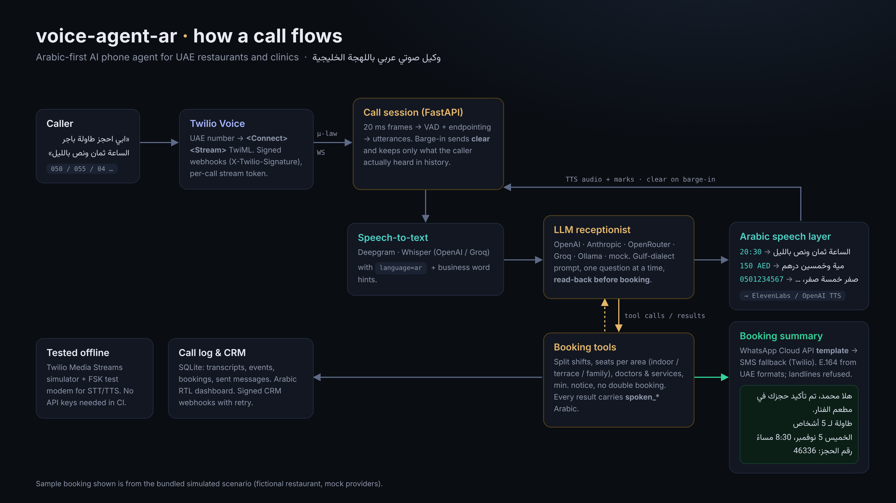

<div dir="rtl">

**العربية** | [English](README.en.md)

# voice-agent-ar: وكيل صوتي عربي بالذكاء الاصطناعي للمطاعم والعيادات في الإمارات

**وكيل صوتي مفتوح المصدر يرد على هاتف نشاطك باللهجة الخليجية الإماراتية، ويحجز الطاولات والمواعيد عبر Twilio، وينطق الأوقات والأسعار كما يقولها موظف في دبي، ويرسل ملخص الحجز للمتصل عبر قالب واتساب أو رسالة SMS.**

[](https://github.com/mohammadhadijavidi/voice-agent-ar/actions/workflows/ci.yml)
[](LICENSE)
[](pyproject.toml)
[](https://www.twilio.com/docs/voice/media-streams)
[](https://developers.facebook.com/docs/whatsapp/cloud-api)



<sub>لقطة حقيقية من لوحة المكالمات المرفقة بعد تشغيل المكالمات المحاكاة المدمجة. المطعم والمتصلون والأرقام بيانات عينة وهمية. ردود المساعد صادرة عن موظف الاستقبال التجريبي <b>mock</b> (قوالب ثابتة وليست ناتج نموذج حقيقي)، أما الحجز والتوفر والمقاطعة وطلب واتساب/SMS (وضع التجربة، لم يُرسل شيء) فناتجة عن الكود الفعلي.</sub>

## لماذا voice-agent-ar؟

المطاعم والعيادات في دبي وأبوظبي تفوّت مكالمات وقت الذروة، وأغلب المتصلين يتكلمون باللهجة الخليجية: «ابي طاولة باجر الساعة ثمان ونص بالليل لخمسة». قوالب الوكلاء الصوتيين الجاهزة مبنية للإنجليزية، وعند تشغيلها بالعربي تتعثر في أماكن متوقعة:

- **الفهم:** «باجر»، «عقب باجر»، «سبع إلا ربع»، «احنا خمسة»، «برا في التراس»، «ايه صح». التواريخ والأوقات وعدد الأشخاص والتأكيد باللهجة الخليجية.
- **النطق:** محركات تحويل النص إلى كلام تقرأ «20:30» و«150 AED» بشكل غير متوقع (أرقام إنجليزية أو «عشرون نقطتان ثلاثون»). المتصل يجب أن يسمع «الساعة ثمان ونص بالليل» و«مية وخمسين درهم».
- **الواقع المحلي:** دوام على فترتين (غداء وعشاء)، وقسم للعائلات، وصيغ الأرقام الإماراتية (050 و055 و+971 والخطوط الأرضية 04)، وتأكيد الحجز عبر واتساب الذي يهم في الإمارات أكثر من البريد الإلكتروني.

توجد منصات تجارية مغلقة لوكلاء صوتيين عرب في الشرق الأوسط، لكن بحثي لم يجد مشروعاً مفتوح المصدر يجمع تصميم محادثة هاتفية باللهجة الخليجية مع منطق حجز حقيقي وتأكيد عبر واتساب. **voice-agent-ar** هو هذا المشروع: خدمة Python صغيرة تشغّلها بنفسك، مع أي مزود للنموذج اللغوي والتعرف على الكلام وتحويل النص إلى كلام، ومختبرة بالكامل دون أي مفتاح API.

هو الأخ العربي لمشروع [voice-agent-starter](https://github.com/mohammadhadijavidi/voice-agent-starter) (قالب عام بالإنجليزية) ويشاركه نواة الصوت: Media Streams وكشف الكلام والمقاطعة والمحاكي.

## المزايا

- **تصميم محادثة باللهجة الخليجية:** أسلوب الهاتف الإماراتي («حياك الله»، «أبشر»، «صح كذا؟»)، وسؤال واحد في كل مرة، و**تكرار تفاصيل الحجز على المتصل قبل التسجيل** بشكل إلزامي: أداة `create_booking` ترفض الحجز ما لم يكن `confirmed_by_caller=true`. وضع الفصحى (`DIALECT=msa`) للأنشطة التي تفضل العربية الرسمية. المتصل بالإنجليزية يُرد عليه بالإنجليزية.
- **الأرقام والأوقات العربية كما ينطقها الناس** (`arabic/numbers.py` و`arabic/speak.py`): الساعات مع «ونص» و«وربع» و«إلا ربع» و«إلا ثلث» وفترة اليوم (الصبح، الظهر، العصر، المغرب، بالليل)، والمعدود بالمطابقة الصحيحة (شخصين، خمسة أشخاص، إحدعش شخص)، والأسعار بالدرهم، والتواريخ مع «باجر» و«عقب باجر»، وأرقام الهواتف وأكواد الحجز رقماً رقماً بمجموعات محلية. كل جملة من النموذج اللغوي تمر بهذه الطبقة قبل تحويلها إلى صوت، لذلك **لا يصل أي رقم إلى محرك الصوت**، بينما يحتفظ سجل المكالمة بالنص الأصلي.
- **فهم اللهجة الخليجية** (`arabic/gulf.py`): الأيام (باجر، بكرة، الليلة، يوم الخميس، 5/11، خمسة نوفمبر)، والأوقات (ثمان ونص بالليل، على 9، ٤ العصر) مع حسم الساعة حسب أوقات الدوام، وعدد الأشخاص (لخمسة، احنا ستة، انا وزوجتي)، ومكان الجلوس (برا، التراس، قسم العوايل)، والأسماء (على اسم محمد الكعبي)، والموافقة والرفض، والوداع، وطلب موظف، والحالات الطبية الطارئة. الأدوات تقبل هذه الصيغ أيضاً، فيستطيع النموذج تمرير «باجر» أو «ثمان ونص بالليل».
- **صيغ الأرقام الإماراتية** (`arabic/phone.py`): ‎`050 123 4567` و‎`+971 50…` و‎`00971…` والأرقام الهندية (٠٥٥…) والأرقام المنطوقة كلمات، وكلها تتحول إلى صيغة E.164. بادئات الموبايل 050/052/054/055/056/058 والخطوط الأرضية 02/03/04/06/07/09. الرقم الأرضي لا يستقبل واتساب، فيطلب المساعد رقم موبايل.
- **منطق حقيقي للمطاعم والعيادات:** المطعم: فترتا دوام، وإغلاق عند منتصف الليل، وعدد المقاعد لكل قسم في كل جلسة (90 دقيقة)، وحد أقصى لعدد الأشخاص، وحد أدنى لمهلة الحجز. العيادة: خدمات بمدة وسعر، وأطباء بأيام عمل، وتوزيع تلقائي على الطبيب المتاح، ولا موعد يتداخل مع الاستراحة.
- **ملخص الحجز عبر واتساب أو SMS:** **قالب واتساب** عربي جاهز للتقديم (فئة UTILITY، وهو إلزامي لأن المتصل لم يراسلك فلا توجد نافذة 24 ساعة مفتوحة) عبر Cloud API الرسمي، مع بديل SMS عبر Twilio (نص قصير بترميز UCS-2). **وضع التجربة مفعّل افتراضياً**: يُبنى الطلب الفعلي ويُسجّل دون إرسال، ولا يدّعي النظام أنه أرسل شيئاً.
- **سلوك هاتفي طبيعي:** يستطيع المتصل مقاطعة المساعد، فيتوقف (أمر `clear` في Twilio) ولا يبقى في ذاكرة النموذج إلا ما سمعه المتصل فعلاً. تحويل المكالمة لموظف عبر Twilio REST، أو تسجيل رسالة. في العيادة: الحالة الطارئة يُعطى فيها رقم الإسعاف 998 أولاً.
- **أي مزود تريده:** النموذج اللغوي: OpenAI وOpenRouter وGroq وOllama وLM Studio (أي خادم متوافق مع OpenAI عبر base_url) وAnthropic وmock. التعرف على الكلام: OpenAI ‏(gpt-4o-transcribe / whisper-1) وGroq Whisper وDeepgram. تحويل النص إلى كلام: ElevenLabs (بصيغة ulaw_8000 الأصلية لـ Twilio) وOpenAI. اللغة مثبتة على العربية مع كلمات مساعدة من نشاطك.
- **لوحة مكالمات عربية RTL:** المكالمات، والنصوص، والردود المقطوعة، واستدعاءات الأدوات، وبطاقة الحجز، ومعاينة رسالة واتساب/SMS. مع webhooks موقّعة لأنظمة CRM ‏(n8n وZapier وMake وHubSpot) وطابور إعادة محاولة.
- **مختبر بلا مفاتيح:** محاكي Twilio Media Streams يتصل بالخادم الحقيقي عبر WebSocket حقيقي (μ-law وإطارات 20 مللي ثانية وmark وclear وstop). ‏137 اختباراً و6 سيناريوهات مكالمات كاملة.

## البدء السريع

<div dir="ltr">

```bash
git clone https://github.com/mohammadhadijavidi/voice-agent-ar
cd voice-agent-ar
pip install -e .

# 6 simulated calls, no API keys (mock STT/LLM/TTS, WhatsApp/SMS dry-run)
voice-agent-ar simulate all

# hear how a sentence will be spoken
voice-agent-ar say "حجزك الساعة 20:30 لـ 4 أشخاص، الكشف 150 درهم"
# -> حجزك الساعة ثمان ونص بالليل لأربعة أشخاص، الكشف مية وخمسين درهم

# open the call log of the simulation (path printed at the end)
voice-agent-ar serve --db /tmp/voice-agent-ar-XXXX/sim.db   # http://localhost:8080
```

</div>

للمكالمات الحقيقية:

<div dir="ltr">

```bash
cp .env.example .env        # keys, PUBLIC_URL, Twilio, PROFILE
voice-agent-ar doctor       # what is configured and what is missing
voice-agent-ar serve        # or: docker compose up -d
```

</div>

في لوحة Twilio اضبط Webhook الصوت لرقمك على ‎`POST https://<PUBLIC_URL>/twilio/voice`. الخطوات كاملة، ومنها قالب واتساب ومعرّف مرسل SMS، في [examples/twilio_setup.md](examples/twilio_setup.md).

## الإعدادات

كل شيء يُضبط عبر متغيرات البيئة (انظر [.env.example](.env.example)).

| الطبقة | المتغير | ملاحظات |
|---|---|---|
| النموذج اللغوي | `LLM_PROVIDER`: ‏`openai`، `openrouter`، `groq`، `ollama`، `lmstudio`، `anthropic`، `mock` | أي خادم متوافق مع OpenAI عبر `LLM_BASE_URL`. بث مباشر واستدعاء أدوات. |
| التعرف على الكلام | `STT_PROVIDER`: ‏`openai`، `groq`، `deepgram`، `mock` | ‏`STT_LANGUAGE=ar` افتراضياً، وكلمات `stt_hints` من ملف النشاط تُرسل كـ prompt ‏(Whisper) أو keyterms ‏(Deepgram، اختياري). |
| تحويل النص إلى كلام | `TTS_PROVIDER`: ‏`elevenlabs`، `openai`، `mock` | ‏`TTS_VOICE_AR` و`TTS_VOICE_EN`. ElevenLabs يرجع μ-law 8kHz مباشرة لـ Twilio. |
| تأكيد الحجز | `NOTIFY_CHANNEL`: ‏`whatsapp`، `sms`، `whatsapp_then_sms`، `none` | ‏`NOTIFY_DRY_RUN=true` افتراضياً. واتساب: `WHATSAPP_TOKEN` و`WHATSAPP_PHONE_NUMBER_ID` و`WHATSAPP_TEMPLATE`. ‏SMS: ‏`SMS_FROM` مع Twilio. |
| النشاط | `PROFILE` | ‏`restaurant` أو `clinic` (عينات وهمية) أو مسار ملف YAML الخاص بك ([قالب مطعم](examples/my_restaurant.yaml)، [قالب عيادة](examples/my_clinic.yaml)). |
| الأسلوب | `DIALECT` | ‏`gulf` (افتراضي) أو `msa` للفصحى. |

**أي مزود أفضل للهجة الخليجية؟** الجودة تختلف كثيراً بين المحركات والأصوات وتتغير بسرعة، فجرّب مع متصليك قبل التشغيل الفعلي. نقطة بداية معقولة: ‏`gpt-4o-transcribe` أو Whisper large للتعرف على الكلام، وصوت عربي من مكتبة أصوات ElevenLabs (‏`eleven_flash_v2_5` لزمن استجابة منخفض). لا يدّعي هذا المستودع أي دقة مقاسة لأي مزود.

## أمثلة الاستخدام

**نشاطك الخاص:** انسخ `examples/my_restaurant.yaml` وعدّل أوقات الدوام وأقسام الجلوس والترحيب والرقم، ثم:

<div dir="ltr">

```bash
PROFILE=path/to/file.yaml voice-agent-ar serve
```

</div>

**مكالمة اختبار من تصميمك:**

<div dir="ltr">

```yaml
# examples/custom_scenario.yaml
profile: restaurant
caller: "+971501112233"
steps:
  - say: "السلام عليكم، ابي طاولة في قسم العوايل يوم الجمعة"
  - say: "بنكون سبعة"
  - say: "الساعة سبع ونص بالليل"
  - say: "على اسم ام سعيد"
  - say: "ايه صح"
```

```bash
voice-agent-ar simulate examples/custom_scenario.yaml
```

</div>

**استخدام الطبقة العربية في كودك:**

<div dir="ltr">

```python
from datetime import date
from voice_agent_ar.arabic import gulf, parse_uae_phone, time_to_words
from voice_agent_ar.arabic.speak import to_speech

gulf.parse_day("عقب باجر", date(2026, 11, 4))         # date(2026, 11, 6)
gulf.parse_time("سبع إلا ربع بالليل").resolve()          # "18:45"
gulf.parse_party_size("احنا خمسة اشخاص")                 # 5
parse_uae_phone("٠٥٥ ٢٢٢ ٣٣٤٤").e164                     # "+971552223344"
time_to_words("20:30")                                  # "الساعة ثمان ونص بالليل"
time_to_words("20:30", "msa")                           # "الساعة الثامنة والنصف مساءً"
to_speech("السعر 1250 درهم")                             # "السعر ألف وميتين وخمسين درهم"
```

</div>

**إضافة أداة** (مثل طبق اليوم): انظر [examples/custom_tool.py](examples/custom_tool.py).

مكالمة محاكاة (`voice-agent-ar simulate restaurant_booking`، مزودات mock):

> **المساعد:** مساء الخير، مطعم الفنار، معك مريم. شلون أقدر أساعدك؟<br>
> **المتصل:** السلام عليكم، ابي احجز طاولة باجر الساعة ثمان ونص بالليل<br>
> **المساعد:** حياك الله. كم شخص بتكونون؟<br>
> **المتصل:** بنكون خمسة اشخاص<br>
> **المساعد:** أبشر، عندي طاولة لخمسة أشخاص باجر، الخميس خمسة نوفمبر الساعة ثمان ونص بالليل. على أي اسم أسجل الحجز؟<br>
> **المتصل:** على اسم محمد الكعبي<br>
> **المساعد:** تمام، طاولة لخمسة أشخاص باجر، الخميس خمسة نوفمبر الساعة ثمان ونص بالليل في الصالة الداخلية، على اسم محمد الكعبي. صح كذا؟<br>
> **المتصل:** ايه صح<br>
> **المساعد:** تم الحجز يا محمد الكعبي، رقم الحجز أربعة ستة ثلاثة ثلاثة ستة. أرسل لك التأكيد على الواتساب على الرقم اللي آخره أربعة خمسة ستة سبعة؟<br>
> **المتصل:** ايه ارسله على الواتساب<br>
> **المساعد:** أبشر، بيوصلك ملخص الحجز على الواتساب على الرقم اللي آخره أربعة خمسة ستة سبعة. تبي شي ثاني؟

## كيف يعمل



1. تصل المكالمة إلى رقمك في Twilio. يتحقق `/twilio/voice` من توقيع `X-Twilio-Signature` ويرجع TwiML من نوع `<Connect><Stream>` مع رمز خاص بالمكالمة.
2. يبث Twilio الصوت (μ-law بتردد 8kHz) عبر WebSocket، وتقسمه الجلسة إلى عبارات بكشف الكلام وتحديد نهاية الجملة.
3. كل عبارة تذهب إلى التعرف على الكلام (لغة `ar` مع كلمات النشاط)، ثم يذهب النص ورسالة النظام (أسلوب خليجي وقواعد التدفق وحقائق النشاط) إلى النموذج اللغوي.
4. يستدعي النموذج الأدوات: `check_availability`، و`create_booking` (بعد موافقة المتصل على التفاصيل فقط)، و`send_booking_summary`، و`cancel_booking`، و`transfer_to_human`، و`take_message`، و`end_call`. نتائج الأدوات تحمل حقول `spoken_*` جاهزة للنطق.
5. كل جملة تمر عبر `to_speech()` (الأرقام والأوقات والأسعار والهواتف إلى كلمات عربية)، ثم تحويل النص إلى كلام، ثم تعود إلى Twilio مع `mark`. إذا تكلم المتصل فوق المساعد يُرسل `clear` ولا يبقى في الذاكرة إلا ما سُمع.
6. بعد الحجز يُرسل قالب واتساب (أو SMS) لموبايل المتصل، ويستلم نظام CRM حدثي `booking.created` و`call.completed` مع ملخص عربي.

خريطة الكود: `arabic/` (الطبقة اللغوية) · `prompts.py` (تصميم المحادثة) · `tools.py` (منطق الحجز) · `notify.py` (واتساب وSMS) · `agent.py` (جلسة المكالمة) · `simulator.py` (محاكي Twilio) · `providers/` (المزودات).

## خارطة الطريق

- تعرف على الكلام بالبث المباشر (Deepgram live أو OpenAI realtime) لتقليل زمن الاستجابة.
- مقارنة مزودات التعرف على الكلام وتحويل النص إلى كلام على مكالمات خليجية مسجلة بموافقة أصحابها.
- تعديل الحجز برقمه، وتذكير قبل الموعد بيوم عبر قالب واتساب.
- مزامنة مع Google Calendar وأنظمة حجز المطاعم.
- لهجات أخرى: السعودية (نجدية وحجازية) والكويتية والمصرية.
- مكالمات صادرة لتأكيد الحجوزات.

## المساهمة

أكثر مساهمة مفيدة: عبارات خليجية لم يفهمها المساعد. أضفها إلى `arabic/gulf.py` مع اختبار. التفاصيل في [CONTRIBUTING.md](CONTRIBUTING.md).

## الترخيص

MIT، انظر [LICENSE](LICENSE). خط Vazirmatn المرفق مرخص بـ SIL Open Font License ‏([OFL.txt](src/voice_agent_ar/static/fonts/OFL.txt)).

التزم بالقوانين وقواعد المنصات في بلدك: أخبر المتصل أنه يتحدث مع مساعد آلي، واحتفظ بالتسجيلات والنصوص فقط بما تسمح به سياسة الخصوصية لديك (قانون حماية البيانات الشخصية في الإمارات)، واستخدم قوالب واتساب المعتمدة فقط، وسجّل معرّف مرسل الرسائل النصية.

---

</div>

Built by [Mohammad Hadi Javidi](https://github.com/mohammadhadijavidi) — AI products & automation, Dubai.
